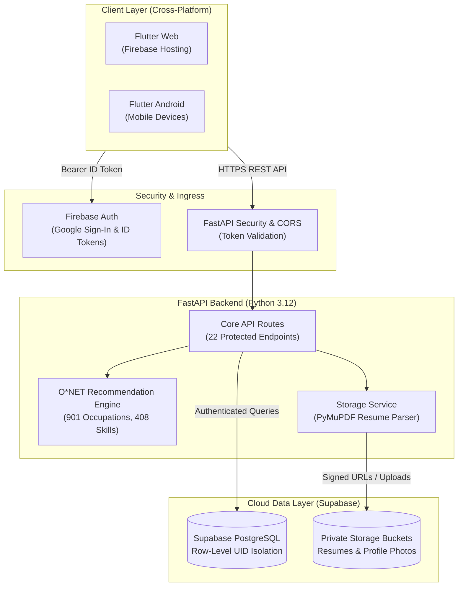

# CareerPath — AI-Powered Student Career Roadmap & Intelligence Platform

[](https://flutter.dev)
[](https://fastapi.tiangolo.com)
[](https://firebase.google.com)
[](https://supabase.com)
[](https://www.onetcenter.org/)
[](https://github.com)

**CareerPath** is an end-to-end intelligent career guidance platform designed for undergraduate students. It bridges the critical transition between academic studies and industry employment by providing objective, data-driven career recommendations, automated skill-gap analysis, interactive career roadmaps, AI advisory chat, and private resume management.

---

## 1. Overview & Objectives

Many university students struggle to identify suitable career paths, assess how their current coursework matches real-world industry demands, or bridge actionable skill gaps. CareerPath solves this problem by integrating standardized labor-market intelligence from the U.S. Department of Labor's **O\*NET 28.0 database** with modern machine-learning recommendation techniques.

### Core Objectives:
- **Objective Matching:** Replace guesswork with algorithmic similarity matching between student profiles and 900+ standardized career occupations.
- **Actionable Gap Analysis:** Automatically determine which essential and technical skills a student possesses versus what their target occupation requires.
- **Dynamic Guidance:** Generate structured 4-year academic roadmaps, relevant online courses, and internship recommendations tailored to the student's academic year.
- **Secure & Private:** Enforce enterprise-grade authentication, row-level student data isolation, and private cloud storage for resumes and academic documents.

---

## 2. Key Features

- **Multi-Factor Authentication:** Seamless Google Sign-In with pre-verified email claims, alongside traditional Firebase email/password registration.
- **4-Step Onboarding Wizard:**
  - Step 1: Basic profile & academic level (Years 1–4).
  - Step 2: Primary interest domain selection (e.g., Software Engineering, Data Science, Cybersecurity).
  - Step 3: Interactive skill inventory tagged from 400+ standardized industry competencies.
  - Step 4: Academic background review and confirmation.
- **Personalized Recommendation Engine:** Real-time top-5 career matches with algorithmic match percentage scores based on Jaccard skill similarity and RIASEC domain alignment.
- **Skill Gap & Readiness Analysis:**
  - Visual circular progress indicator of student readiness.
  - Breakdown of matched skills (green) and missing required competencies (orange/red).
- **Target Career Persistence:** Select and save a target career to synchronize personalized learning roadmaps, recommended certifications, and internship targets across sessions.
- **Interactive AI Career Chatbot:** Real-time bottom-sheet career counseling drawer powered by the FastAPI intelligence backend.
- **Private Resume Management:** PDF resume upload, parsing via PyMuPDF, metadata extraction, and time-limited signed download URLs via Supabase Private Storage.

---

## 3. System Architecture



---

## 4. Technology Stack

| Layer | Technology | Details |
| :--- | :--- | :--- |
| **Frontend** | Flutter 3.47.8 / Dart 3.13.7 | Material 3 Design, Responsive Layouts, CanvasKit Web & Android |
| **Backend API** | Python 3.12 / FastAPI 0.110+ | Asynchronous REST endpoints, Pydantic v2 data contracts, Uvicorn |
| **Authentication** | Firebase Authentication | Google OAuth 2.0 federated sign-in, Firebase Bearer ID tokens |
| **Database** | Supabase (PostgreSQL 15) | Relational student profiles, skill mappings, career selections |
| **Cloud Storage** | Supabase Storage | Private object storage, time-limited presigned URLs |
| **Resume Processing**| PyMuPDF (`fitz`) 1.23+ | Server-side PDF text extraction and security validation |
| **Dataset Engine** | O\*NET 28.0 Database | 901 occupations, 408 standardized skills, RIASEC interest models |
| **Deployment** | Firebase Hosting & Render / Cloud Run | Scalable cloud delivery, HTTPS enforcement, CORS isolation |

---

## 5. Security & Student Data Isolation

- **Zero-Bypass Release Mode:** In production builds (`kReleaseMode == true`), email verification is strictly mandatory. Development testing bypasses are eliminated at compile time via Dart tree-shaking.
- **Route-Level Token Verification:** All 22 student endpoints enforce `get_current_verified_user`. Unverified accounts are rejected with `HTTP 403 Forbidden`.
- **Foreign Key Isolation:** Supabase PostgreSQL records are bound to the student's unique Firebase UID (`firebase_uid`). It is architecturally impossible for a student to view or modify another student's profile.
- **Private Storage Isolation:** Uploaded resumes are segregated by UID paths (`resumes/{firebase_uid}/{file_id}.pdf`). Access is strictly mediated via backend-generated, time-limited presigned URLs.

---

## 6. Local Setup & Installation

### Prerequisites
- **Flutter SDK:** 3.24.0 or newer ([Install Flutter](https://docs.flutter.dev/get-started/install))
- **Python:** 3.11 or 3.12 ([Install Python](https://www.python.org/downloads/))
- **Firebase Account:** Free Spark plan ([Firebase Console](https://console.firebase.google.com/))
- **Supabase Account:** Free tier ([Supabase Console](https://supabase.com/))

### 1. Clone Repository
```bash
git clone https://github.com/ambatichaitu/careerpath.git
cd careerpath/backend/careerpath
```

### 2. Backend Setup
1. Create and activate a Python virtual environment:
   ```bash
   python -m venv venv
   # Windows:
   .\venv\Scripts\activate
   # macOS/Linux:
   source venv/bin/activate
   ```
2. Install dependencies:
   ```bash
   pip install -r requirements.txt
   ```
3. Configure environment variables:
   Copy `.env.example` to `.env` and fill in your keys:
   ```bash
   cp .env.example .env
   ```
   ```ini
   ENVIRONMENT=development
   PORT=8000
   FIREBASE_PROJECT_ID=your-firebase-project-id
   SUPABASE_URL=https://your-project.supabase.co
   SUPABASE_SECRET_KEY=your-supabase-service-role-key
   ALLOWED_ORIGINS=http://localhost:8000,http://127.0.0.1:8000,https://your-firebase-app.web.app
   ```
4. Initialize the database schema:
   Execute the migration SQL file in your Supabase SQL Editor:
   [`supabase/deploy_all_migrations.sql`](supabase/deploy_all_migrations.sql)
5. Start the FastAPI server:
   ```bash
   python -m uvicorn main:app --host 127.0.0.1 --port 8000 --reload
   ```
   Verify at `http://127.0.0.1:8000/`.

### 3. Frontend Setup (Flutter)
1. Install Flutter dependencies:
   ```bash
   flutter pub get
   ```
2. Configure Firebase:
   Run the FlutterFire CLI to generate your `firebase_options.dart`:
   ```bash
   flutterfire configure
   ```
3. Run on Chrome (Web):
   ```bash
   flutter run -d chrome
   ```
4. Run on Android:
   ```bash
   flutter run -d <device-id>
   ```

---

## 7. Recommendation Engine Details

The recommendation engine maps student skills and academic interests against 901 occupations indexed from O\*NET:

1. **RIASEC Domain Filtering:** Filters occupations aligned with student interest categories (Realistic, Investigative, Artistic, Social, Enterprising, Conventional).
2. **Jaccard Skill Similarity:** Computes overlap between student-selected skills and occupational requirements:
   $$\text{Match \%} = \frac{|S_{\text{student}} \cap S_{\text{role}}|}{|S_{\text{role}}|} \times 100$$
3. **Weight Adjustments:** Applies academic year weightings to balance aspirational roles against near-term entry requirements.
4. **Skill-Gap Identification:** Classifies competencies into:
   - **Matched Skills:** Present in student profile.
   - **Missing Core Skills:** Required high-importance competencies needed for mastery.
   - **Recommended Tech:** Industry software tools relevant to the target occupation.

---

## 8. Testing & Quality Assurance

The codebase includes an extensive suite of **66 automated tests**:

```bash
# Run Flutter Widget & Unit Tests (13 tests)
flutter test

# Run Flutter Static Analysis
flutter analyze

# Run Backend Pytest Suite (53 tests)
pytest test_backend.py -v
```

### Test Coverage Highlights:
- Firebase Bearer token validation and 401 rejection on unauthenticated endpoints.
- Email verification enforcement (403 Forbidden on unverified accounts in production mode).
- Supabase student profile CRUD and foreign-key isolation.
- O\*NET recommendation scoring accuracy and edge case handling.
- Resume upload, magic-number PDF validation, and MIME-type safety checks.

---

## 9. Known Limitations & Future Improvements

- **Cold Starts on Free Tiers:** Free serverless hosting tiers (e.g. Render Free) sleep after 15 minutes of inactivity, resulting in a ~30s wake-up delay on the first request.
- **Future Enhancements:**
  - AI-driven automated resume bullet-point suggestions using Google Gemini Live API.
  - Real-time job board integration (LinkedIn / Indeed API) matching live openings to the student's target roadmap.
  - Multi-tenant university administration dashboard for academic advisors.

---

## 10. Dataset Attribution & Licensing

- **O\*NET Database:** This project incorporates occupational and skill data from the **O\*NET 28.0 Database** by the U.S. Department of Labor, Employment and Training Administration (USDOL/ETA). Used under the [Creative Commons Attribution 4.0 International (CC BY 4.0)](https://creativecommons.org/licenses/by/4.0/) license.
- **Source Code License:** Open source under the terms of the MIT License (see `LICENSE` file).
